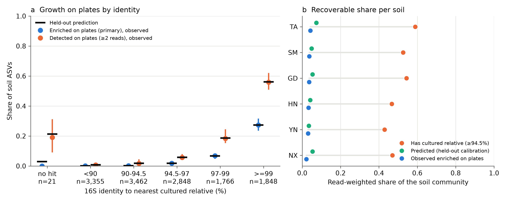

# plate-truth

**Does having a cultured relative mean a microbe will actually grow?**
A cross-study test, against real plate data, of the assumption behind every estimate of the "uncultured majority."

## The question

Estimates of how much of the microbial world can be cultured often rest on a shortcut: if an environmental 16S sequence closely matches a strain that someone has grown in a lab, the organism is treated as culturable. That shortcut is disputed (Lloyd et al. 2018; Martiny 2019; Steen et al. 2019), but it has not been tested directly against what actually grows on plates, across many studies.

This project measures how well 16S identity to the nearest cultured relative predicts whether an environmental taxon grows on plates, and how that relationship changes with habitat, taxon, medium, temperature, oxygen and incubation time.

Throughout, **"predicted to grow"** (a model or database output) is kept strictly separate from **"detected" or "enriched on plates"** (an observation).

## Status

**In progress.** Three stages are complete: a calibration on one soil dataset, a census of the datasets available for the cross-study analysis, and the reprocessing of those datasets into one database. The cross-study model is next.

### First result: the shortcut overstates what grows

Using six soils for which both the soil community and the communities grown from it on plates were sequenced (Zheng et al. 2024, BioProject PRJNA1029248), the probability that a taxon grew on plates rises steeply with its 16S identity to the nearest cultured relative:

| Identity to nearest cultured relative | Taxa enriched on plates | Taxa detected on plates |
|---|---|---|
| below 90% | 0.09% | 0.7% |
| 90–94.5% | 0.17% | 1.7% |
| 94.5–97% | 1.8% | 5.7% |
| 97–99% | 6.8% | 18.3% |
| 99% or above | 27.3% | 55.9% |

Each soil was predicted from the other five, giving a held-out AUC of 0.88 (95% CI 0.87–0.90) for enrichment on plates, with predicted probabilities matching observed rates in every identity band.

A common database shortcut — counting a taxon as culturable if it has a relative at 94.5% identity or above — covers 50% of soil reads, against 3.3% observed enriched on plates and 13.3% detected. That is an overestimate of roughly 15-fold and 3.8-fold respectively.

Two methodological findings came out of this stage: about 1.3% of genome assemblies labelled as isolates in a standard reference carry 16S genes from unrelated phyla, which inflates the apparent supply of cultured relatives; and once reference sequences are trimmed to the sequenced region, whether alignment gaps are counted makes no difference to the result.



Plain-language caption: `figures/captions.md`. Numbers: `results/phase0/`.

### Dataset census

A literature and archive search (1,120 articles screened, 597 sequencing projects checked against their public records) identified 11 independent studies that sequenced both an environmental sample and the plate-grown communities from it, spanning soil, activated sludge, seawater, marine sponge, plant, food and rumen. The summary table is `data/processed/census.csv`; every study's citation and accession is checked against its publisher record and paper by `scripts/21_verify_references.py`.

### Reprocessed dataset

Ten of those studies (the seawater study is held out because its deposited reads were already trimmed in a way that cannot be undone) were reprocessed from raw reads with one pipeline: 1,358 sequencing runs (128 environmental samples, 1,157 plate communities) in 716 plating conditions, 41,393 sequence variants, each with its identity to the nearest cultured relative. The per-study quality report is in `results/phase2/`.

One finding from this stage affects the first result above: in the soil dataset, 58% of reads were deposited without their mate and could not be used, and which reads lost their mate is not random. Counting every read leaves the identity-growth curve nearly unchanged below 99% identity but lowers the share of the closest relatives that grew. The first result above is from complete read pairs only and will be superseded by the cross-study analysis.

**Next:** fitting and validating the cross-study model, with the analysis plan registered before any model is fitted.

All results so far come from a single dataset, under one set of plating conditions, and should be read that way until the cross-study analysis is done.

## Setup

Requires [conda](https://docs.conda.io/) (Miniconda or Anaconda).

```bash
conda env create -f environment.yml
conda activate plate-truth
pip install -e . --no-deps
python scripts/00_get_vsearch.py     # Windows only; on Linux/macOS: conda install -c bioconda vsearch
pytest
```

Copy `.env.example` to `.env` and fill in only the keys you need. Never commit `.env`.

## Repository layout

```
plate-truth/
├── README.md
├── environment.yml
├── pyproject.toml
├── config/                 # thresholds, paths, study list (YAML)
├── data/
│   ├── raw/                # downloads (not in git)
│   ├── interim/            # intermediate files (not in git)
│   └── processed/          # small harmonized tables (in git)
├── src/plate_truth/        # importable package
├── scripts/                # numbered pipeline entry points, in run order
├── tests/                  # pytest
├── notebooks/              # exploration only, never imported
├── results/                # model outputs and tables
├── figures/                # figures and captions
├── app/                    # Streamlit tool
└── manuscript/             # preprint draft
```

`data/plate_truth.sqlite` (the harmonized database) is rebuilt by the pipeline and is not kept in git.

## Author

Owen Swanson ([@oswan-1225](https://github.com/oswan-1225)).

## Citing

Not yet available. A bioRxiv preprint and a Zenodo data release are planned.
