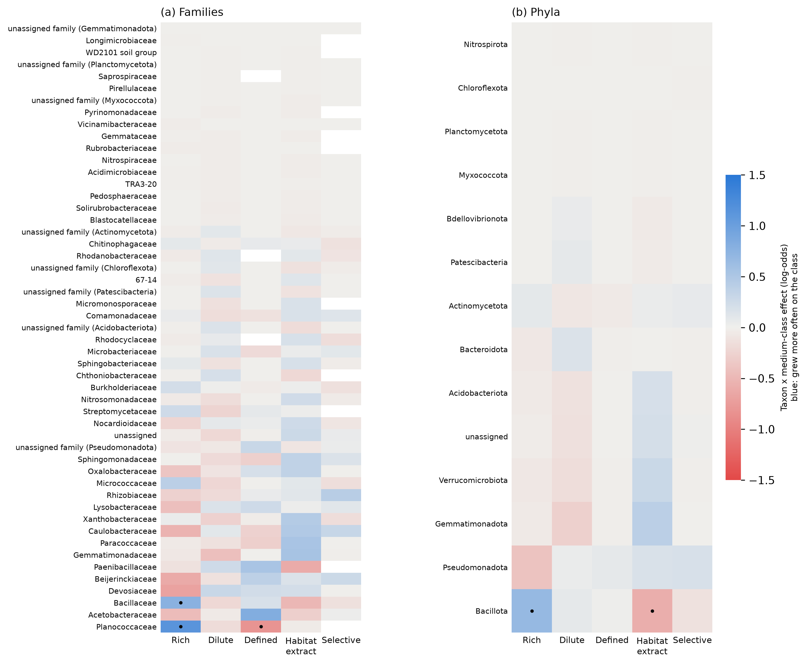

# Abstract

Estimates of how much of the microbial world can be cultured often rest on a shortcut: an environmental 16S rRNA gene sequence that closely matches a cultured strain is counted as culturable. Whether that inference holds has been argued in print but not tested against what actually grows. I assembled 11 public datasets from 10 independent studies in which both an environmental sample and the communities grown from it on agar plates were sequenced, spanning soil, activated sludge, a marine sponge, oak, broiler carcasses and rumen. All reads were reprocessed with one pipeline, and for 665,023 combinations of sequence variant and plating condition I asked whether identity to the nearest cultured relative predicts enrichment on plates, with every performance number computed on a study the model was not fitted on. Identity ranked taxa well in new studies, with a mean held-out AUC of 0.801 (0.715-0.870), but the overall level of growth differed between studies more than tenfold and could not be predicted (observed-to-expected ratios 0.20 to 2.81). The shortcut "has a cultured relative at 94.5% identity or above" overstated the share of the community that was enriched on plates in every study, by a median factor of 5.91 (3.88-33.00). Most bacterial families grew less often than relatedness predicts, and culture-collection records of the media strains are kept on carried no medium-specific information once studies were allowed their own baselines. Applied to 28 public surveys from seven habitats, the shortcut counted 44% to 98% of reads as culturable, above what one plating is predicted to recover even in a high-recovery study in every habitat. A cultured relative is useful for ranking which taxa are likely to grow, but it is not a measure of how much of a community can be grown.

# Introduction

Many bacterial lineages detected by sequencing have no cultivated representative, and in soil, seawater and freshwater many abundant organisms are only remotely related to any strain that has been characterized (Rappé and Giovannoni 2003). How large this uncultured majority is matters for how much of microbial physiology can be studied in the laboratory. Two kinds of estimate dominate. One counts taxa or cells whose 16S rRNA gene sequences fall in lineages without any cultured member (Lloyd et al. 2018). The other counts the share of sequences that have a close cultured relative and treats those as culturable (Martiny 2019). The second reading led Martiny to conclude that a median of 97.3% similarity to cultured relatives, and about half of sequences with a relative above 97%, meant the "1% culturable" paradigm was no longer correct (Martiny 2019). Steen and colleagues replied that the conclusion rested on technical errors, notably identity calculations that ignore gaps and amplicon primers that favour cultured organisms, and on a conceptual one: similarity to a cultured strain cannot be used to infer culturability, because physiology cannot be read from a 16S sequence (Steen et al. 2019).

Both positions rest on a claim that can be tested directly but, as far as I can find, has not been: that a sequence with a cultured relative will grow when the community is plated. Many studies have sequenced plate-grown communities alongside the source community (Lau et al. 2016; Zheng et al. 2024), and some report that cultivated taxa are closer to type strains than uncultivated ones while noting that closely related taxa often fail to grow (Zheng et al. 2024). Others predict cultured status from genome content, with cultured status taken from databases rather than plates (Oduwole et al. 2025). What is missing is a calibration: across independent studies, how does the probability that a taxon grows on plates change with its identity to the nearest cultured relative, and is that probability transferable to a study the model has not seen?

I tested this with public datasets in which an environmental sample and the communities grown from it on plates were both sequenced. I reprocessed every dataset with one pipeline, measured identity to cultured strains over each study's own amplified region with gaps counted, and defined growth as enrichment on plates relative to the source community, so that DNA carried over from the inoculum is not counted as growth. Hypotheses, models, metrics and criteria were registered before any model was fitted, and every performance number comes from a study held out of the fit. I then asked which plating conditions and taxa shift the relationship, whether culture-collection records of the media strains are kept on predict the medium a taxon grows on, and what the calibrated model implies for public surveys of habitats in which the shortcut has been used to estimate culturability.

# Results

## Ten studies with paired environmental and plate-grown communities

A search of 1,120 articles and 597 sequencing projects identified 11 independent studies that sequenced an environmental sample and plate-grown communities from it, with raw reads public and the two linkable. One seawater study was held out because its deposited reads had been trimmed so that identity could not be measured over the same window as in the others. The remaining 11 datasets from 10 study groups (1,358 sequencing runs: 128 environmental libraries and 1,157 plate communities) gave 41,393 amplicon sequence variants (ASVs) in 716 plating conditions (Fig. 1). After the depth rule, 687 conditions and 665,023 combinations of ASV and condition remained, of which 39,280 were enriched on plates (at least 5 reads and at least twice the source relative abundance). The studies differ in nearly every respect a plating experiment can differ: from 4 to 360 conditions per study, 1 to 15 source samples, 5 medium classes, incubation from cold to warm and from aerobic to anaerobic (Fig. 1b).

## Identity ranks taxa in a new study, but does not set the level

The probability that an ASV was enriched rose with identity to its nearest cultured relative (Fig. 2a). For a study the model had not seen, the predicted rate was 1.1% (0.2%-5.5%) at 90% identity, 3.6% (0.8%-14.2%) at 94.5%, 4.8% (1.1%-17.6%) at 97%, 5.3% (1.2%-18.8%) at 99% and 7.8% (1.9%-25.3%) for an exact match. No ASV without a cultured relative at 75% identity or above was enriched (0 of 3,059). Even at 99% identity, then, most taxa with a cultured relative did not grow on the plates used, and the spread between studies was wide: at 99% identity the 10th to 90th percentile across studies ran from 1.1% to 11.4%.

Held out one study group at a time, identity alone ranked taxa better than chance in 9 of 10 groups, with a mean AUC of 0.801 (0.715-0.870); H1 was supported (Table 1; Fig. 2b). Identity added to source abundance, plating conditions and phylum: the full model's mean held-out AUC exceeded that of the same model without identity by 0.073 (0.029-0.123), supporting H4. A gradient-boosting model with the same features reached a mean AUC of 0.788 (0.713-0.853), against 0.781 (0.696-0.852) for the mixed model, so the simpler model does not miss much structure. Ranking was poor in two studies: the broiler-carcass study (AUC 0.507), where most reads already have a close cultured relative, and the desert-soil study (AUC 0.608).

The level of growth did not transfer (H2 not supported). The ratio of observed to expected enrichments in held-out studies ranged from 0.20 to 2.81: 6 groups fell below the registered range (0.67 to 1.5), where the model over-predicted, and 3 above it, where it under-predicted (Fig. 2c). No group had both a calibration slope and an observed-to-expected ratio inside the registered ranges. The overall growth rate of a new study is the main unknown, not the shape of the curve.

| Hypothesis | Criterion (registered) | Result | Verdict |
|---|---|---|---|
| H1 identity ranks growth | identity-only held-out AUC > 0.5 in at least 8 of 10 groups and the interval of the mean AUC above 0.5 | 9 of 10 groups; mean AUC 0.801 (0.715-0.870) | supported |
| H2 calibrated across studies | calibration slope 0.8-1.25 and O/E 0.67-1.5 in at least 7 of 10 groups | 0 of 10 groups; O/E 0.20-2.81 | not supported |
| H3 the shortcut overstates recovery | shortcut / observed > 1 in at least 8 of 10 groups and the interval of the median ratio above 1 | 10 of 10 groups; median 5.91 (3.88-33.00) | supported |
| H4 identity adds to covariates | mean held-out AUC higher with identity than without, interval of the difference above 0 | AUC gain 0.073 (0.029-0.123) | supported |

Table 1. Registered hypotheses and held-out results. Intervals are 95% bootstrap intervals over study groups. The medium and curation hypotheses (H5, H6) are reported in their own sections below.

## The shortcut overstates recovery in every study

In each study I compared three read-weighted shares of the source community: reads with a cultured relative at 94.5% or above (the shortcut), reads in ASVs enriched in at least one plating condition (observed), and the held-out prediction (Fig. 3a). The shortcut exceeded the observed share in 10 of 10 groups, by a median factor of 5.91 (3.88-33.00), supporting H3 (Fig. 3b). The factor ranged from 3.1 in the broiler-carcass study to 183 in the sponge study. Using "enriched in any condition" as the observed share is the most generous reading for the shortcut; per condition the gap is larger.

Of 16 sensitivity analyses, 14 left every verdict unchanged, including different read and fold thresholds, identity definitions, cultured references, depth rules, count tables and a copy-number correction. Two changed a verdict. When "grew" is replaced by mere detection on plates (at least 2 reads, no fold rule), the shortcut no longer clearly overstates recovery (median factor 1.73, lower bound 0.93): detection counts DNA carried over from the inoculum, which tracks the source community. Dropping the three single-source studies left 7 groups, and identity ranked better than chance in 5 of them, one short of the scaled criterion; the shortcut verdict held there.

## What shifts the curve

In a model that let the curve differ between habitat types, host-associated habitats had a predicted rate of 2.7% (0.5%-11.7%) at 90% identity against 0.6% (0.1%-2.8%) in environmental habitats, and 3.6% (0.7%-14.5%) against 6.1% (1.5%-19.6%) at 99%, with wide, overlapping intervals (Fig. 4a). How sharply identity separated growers from non-growers differed between studies: held-out calibration slopes ranged from 0.13 to 2.68 (Fig. 4b). Above 1, identity separated growers more sharply in that study than the model expected (the rumen and sponge studies); near 0, identity barely ranked (the broiler and desert-soil studies). Studies therefore differ in the strength of the identity effect as well as in level.

Plating conditions shifted the curve much less than the study did (Fig. 4c). Relative to the average medium class, dilute media had an odds ratio of 1.43 (1.26-1.63) and habitat-extract media 1.30 (1.11-1.53), against 0.42 (0.28-0.63) for selective media, which contain antibiotics. Warm incubation (33 °C or above) had an odds ratio of 0.67 (0.62-0.72) relative to the average temperature band, and each doubling of incubation time 0.74 (0.67-0.80). Abundant taxa passed the fold rule less often: each tenfold increase in source abundance had an odds ratio of 0.67 (0.66-0.69), as expected for a rule that asks a taxon to double its share. Because the study random effect absorbs differences between studies, these condition effects are estimated mainly from studies that varied conditions internally, and the warm band rests on 2 studies.

If the level of a new study is the main unknown, a small local pilot could fix it. In an exploratory analysis (not registered), a share of each held-out study's plating conditions recalibrated the predictions and only the remaining conditions were scored. Shifting the level alone brought the observed-to-expected ratio into range in 10 of 10 groups even with a 10% pilot, but the slope stayed out of range in 6; recalibrating level and slope met the registered calibration bar in 7 of 10 groups with a 25% pilot and 9 with a 50% pilot.

## Medium preferences exist within studies but do not transfer

In the 5 studies that plated on two or more medium classes, families differed in which classes favoured them: the standard deviation of family-by-medium effects was 0.50 on the log-odds scale (likelihood-ratio test, p < 0.001; H5a supported; Fig. 5). The clearest signal was Bacillota on rich media (Bacillaceae +0.76 (0.24 to 1.29), Planococcaceae +1.13 (0.53 to 1.72) on the log-odds scale); only 3 of 242 reported family-by-class cells had an interval excluding zero, all of them in Bacillota. These preferences did not help predict a held-out study: held-out log loss improved in only 3 of 5 groups (mean change -0.0011 (-0.0029 to 0.0006); H5b not supported).

Culture collections record the media each strain is kept on. In the registered test, a taxon whose linked collection strains were all recorded on the plate's own medium class was more likely to be enriched there than one whose strains were recorded on none with an odds ratio of 1.50 (1.39-1.61), and held-out log loss improved in 5 of 5 groups (H6 supported as registered; Supplementary Fig. S1). An exploratory check, added after this result was seen, allowed each study its own effect of the recorded classes. The match effect then disappeared, with an odds ratio of 1.06 (0.96-1.16), and within single studies it pointed in opposite directions: 1.80 (1.51-2.14) in the desert-soil study and 0.83 (0.74-0.94) in the Zheng soils and sludge. The registered result mostly reflects differences between studies: taxa whose relatives are kept on dilute media did well on every plate in the study with the most dilute plates. Whether collection records carry medium-specific information is not established by these data.

## Most families grow less often than relatedness predicts

Compared with a model of identity, source abundance and conditions without taxonomy, shifted to each study's own overall rate, 48 of 80 evaluated families were systematically under-recovered and 3 over-recovered: Pseudomonadaceae, Aeromonadaceae and Rhizobiaceae, with observed / expected ratios of 2.26 (2.09-5.79), 1.65 (1.07-3.72) and 1.56 (1.15-2.37) (Supplementary Fig. S2). 16 under-recovered families had no enriched rows at all. At phylum level, 8 of 14 evaluated phyla were under-recovered, including Acidobacteriota at 0.03 (0.00-0.07), Verrucomicrobiota at 0.14 (0.00-0.26) and Planctomycetota at 0.00. Having a cultured relative is far weaker evidence of growth for an acidobacterium or a planctomycete than for a pseudomonad.

## Public surveys: the shortcut against what one plating could recover

Because a new study's level cannot be predicted, no single recoverable fraction can be given for any habitat. What can be tested without knowing the level is whether the shortcut exceeds even the upper end of the range a plating experiment is predicted to recover. I applied the full model to 28 MGnify survey studies with usable samples (23 amplicon studies with 164 samples, 5 shotgun studies with 23 samples), selected in a fixed random order by rules registered before any sample was processed, averaging over the plating conditions of the training studies.

The procedure was first applied to each training study with a model that had not seen it. The predicted upper end of the one-plate range was at or above the observed recovery in 9 of 10 studies, so it works as an upper reference. The range itself was too narrow at the low end, containing the observed recovery in only 6 of 10 studies (registered bar 7), so it is not read as the spread of real studies (Supplementary Fig. S3).

In every habitat and in both survey types, the shortcut exceeded the upper end of what one plating is predicted to recover in a high-recovery study (Fig. 6; Table 2). The difference ranged from 0.50 (0.35-0.59) in soil to 0.88 (0.64-0.94) in human gut in the amplicon surveys, and it was positive in every study. A more generous reference, recovery on any of eight plates assuming the plates are independent, was still below the shortcut on average in every habitat, but the difference was clear only in the human gut, where it was 0.51 (0.05-0.84). The registered verdict held under every sensitivity analysis (identity definitions, condition weighting, sample depth, V4 studies only, and without a laboratory-reactor study).

| Habitat | Studies / samples | Shortcut | One plate, 10th-90th percentile study | Shortcut minus one-plate upper end |
|---|---|---|---|---|
| Soil | 2 / 16 | 0.56 (0.51-0.61) | 0.005-0.057 | 0.50 (0.35-0.59) |
| Activated sludge | 2 / 12 | 0.83 (0.78-0.88) | 0.008-0.086 | 0.74 (0.49-0.84) |
| Plant | 2 / 16 | 0.78 (0.73-0.84) | 0.008-0.090 | 0.69 (0.45-0.80) |
| Marine water * | 4 / 30 | 0.67 (0.54-0.89) | 0.006-0.064 | 0.61 (0.38-0.82) |
| Marine sediment * | 3 / 18 | 0.58 (0.23-0.86) | 0.006-0.064 | 0.52 (0.23-0.77) |
| Freshwater * | 5 / 36 | 0.68 (0.57-0.75) | 0.007-0.079 | 0.60 (0.38-0.71) |
| Human gut * | 5 / 36 | 0.96 (0.94-0.98) | 0.007-0.077 | 0.88 (0.64-0.94) |

Table 2. Amplicon surveys. Shares of reads; intervals are 95% intervals over studies and fixed-effect draws. Habitats marked * have no training study (extrapolation). Shotgun surveys: soil (1 / 3) shortcut 0.44, difference 0.39 (0.25-0.43); plant (1 / 5) shortcut 0.90, difference 0.80 (0.56-0.87); human gut (3 / 15) shortcut 0.98, difference 0.92 (0.73-0.98) (studies / samples; the soil row is one soil sequenced several times).

The composition of the surveys adds a level-free reason for caution. In soil surveys, 0.51 of reads belonged to families that were under-recovered in the training studies, and 0.44 of reads counted as culturable by the shortcut sat in such families; in the human gut the shares were 0.30 and 0.31. In the marine habitats most reads were in families the training data could not evaluate (0.51 in marine water and 0.75 in marine sediment), so composition says little there (Supplementary Fig. S4).

The shortcut shares here are much higher than the metagenome-based shares of cells in cultured species to genera reported by Lloyd et al. (for soil 18%, against 56% here) and similar to Martiny's 52% of sequences with a cultured relative above 97% (Lloyd et al. 2018; Martiny 2019). Primer bias towards cultured taxa (Steen et al. 2019), a reference set that includes isolate genomes and strain collections, and different definitions of "cultured relative" are likely reasons; these data cannot separate them. The test above does not depend on which estimate is right: whichever is used, it is several times what one plating is predicted to recover.

# Discussion

The shortcut at the centre of the culturability debate makes a testable claim, and against plate data it fails in a specific way. Identity to the nearest cultured relative is real information: it ranks which taxa in a new study are likely to grow, adds to what abundance and conditions predict, and nothing without a cultured relative at 75% identity grew. But a cultured relative is not a measure of how much of a community grows. Most taxa with a close relative were not enriched, the shortcut overstated recovery in every study, and the overall level of growth varied between studies more than tenfold for reasons the recorded conditions did not explain.

This bears on both sides of the debate. Steen and colleagues argued that similarity cannot be used to infer culturability (Steen et al. 2019); the results support that as a statement about levels, while showing that similarity does carry ranking information. Martiny's estimate (Martiny 2019) is not contradicted as a count of sequences with cultured relatives, which the survey shares here resemble, but it cannot be read as the share of a community that grows when plated. Gap handling, one of the technical criticisms, made little difference once references were cut to the amplified region.

The finding that most families grow less often than their relatedness predicts, and that recovery concentrates in a few Pseudomonadota families, fits the long-standing observation that standard plates favour fast-growing copiotrophs. It also means that culturability inferred from relatives is least reliable for exactly the lineages, such as Acidobacteriota, Planctomycetota and Verrucomicrobiota, that dominate many soils.

Several limitations apply. Ten study groups are few for estimating between-study variation, and plating conditions in published studies are not a random sample of possible conditions; predictions apply to conditions like those studied. Plate scrapings measure enrichment of DNA on a plate, not colony counts or isolation success. Amplicon regions differ between studies and are confounded with study. Culture-collection coverage is biased towards clinical and industrial taxa. Five of the survey habitats have no training study, the survey studies are those deposited in MGnify rather than a random sample of each habitat, and the predicted range is too narrow at its low end. "Any of K plates" assumes independence between plates and overstates recovery. Finally, the enrichment definition guards against carryover DNA but cannot rule out every artefact; with detection alone the shortcut verdict does not hold, which is itself the reason growth was defined by enrichment.

A calibrated estimate of how much of a habitat can be cultured would need what these data lack: many more studies with shared protocols, or a local pilot plating to fix the level, which in the exploratory analysis brought most studies into calibration. Until then, "has a cultured relative" is best treated as a ranking of candidates for cultivation, not as an estimate of how much of a community can be grown.

# Methods

## Pre-registration

The analysis plan (hypotheses, models, metrics, inference criteria and sensitivity analyses) was committed to the public repository before any model was fitted, and extended before each later stage: the medium and taxon analyses before any of their models was fitted, and the survey application before any survey sample was processed. Three deviations and three exploratory analyses, each dated and justified, are listed in the plan; none changed a registered verdict.

## Study census and inclusion

Studies were found by Europe PMC searches combining plate-scraping and culture-enriched profiling terms with 16S amplicon sequencing (1,120 unique articles), followed by a check of every linked sequencing project against its ENA run records (597 projects). Inclusion required raw reads in a public archive, environmental and plate samples linkable to the same source sample, medium and temperature reported, and 16S amplicon data. Every study's DOI, first author, year and accession were checked against its Crossref record and the paper's full text by script.

## Read processing

All studies were processed with one pipeline: primer removal and cutting to the study's amplified window with cutadapt (Martin 2011), read merging, an expected-error filter (maxEE 1) and region-specific length windows with VSEARCH (Rognes et al. 2016), pooled denoising per study with UNOISE3 (Edgar 2016b) and de novo chimera removal, and mapping of every run's reads to the ASVs at 97% identity. Taxonomy was assigned with SINTAX (Edgar 2016a) against SILVA 138.2 (Quast et al. 2012) with a cutoff of 0.8. Chloroplast, mitochondrial and non-prokaryotic ASVs were removed before anything was counted. For the Zheng et al. datasets, whose reads were partly deposited without mates, counts came from every read; the paired-read counts are a sensitivity analysis.

## Cultured reference and nearest-relative identity

The cultured reference combined 16S sequences of culture-collection strains from BacDive (Reimer et al. 2022), NCBI RefSeq targeted-loci 16S sequences of type material, and 16S genes from isolate genomes in GTDB release 232 (Parks et al. 2022); sequences from metagenome-assembled or single-cell genomes were excluded. 5,486 of 427,861 isolate genomes (1.3%) carried 16S genes from unrelated phyla and were removed. For each study, the reference was cut in silico to the study's primer pair, and each ASV's identity to its best hit was computed by global alignment with all gaps counted (VSEARCH `--iddef 1`). ASVs without a hit at 75% or above were "no hit". Identity ignoring terminal gaps and gap-blind identity were sensitivity analyses.

## Outcome and unit of analysis

The unit of analysis was one ASV in one usable plating condition (study, source sample, medium, oxygen, temperature, incubation time), restricted to ASVs present in the condition's source sample (at least 2 environmental reads). A condition was usable if its pooled plate reads and its source's pooled environmental reads both reached 1,000 prokaryotic reads. The primary outcome, enriched on plates, required at least 5 reads in the condition's plates and a plate relative abundance at least twice the source relative abundance: DNA carried over from the inoculum should track its source abundance, while growth should raise it. Detection (at least 2 reads) was a secondary outcome. The shortcut counted an ASV as having a cultured relative if its identity was at least 94.5%.

Media were classed by one ordered rule from recipe facts: selective (antibacterial agents), habitat extract (soil, sludge, rumen fluid or similar), defined, dilute complex (at most 4 g/L organic matter) and rich complex. Temperatures were banded as cold (20 °C or below), moderate, or warm (33 °C or above).

## Calibration model

The primary model was a mixed-effects logistic regression fitted with glmmTMB (Brooks et al. 2017) in R: a natural cubic spline of identity (boundary knots 75 and 100%, interior knots 90, 94.5, 97 and 99%) with a no-hit indicator, log10 source relative abundance, log10 plate pool depth, medium class, temperature band, oxygen and log2 incubation days as fixed effects, with sum-to-zero coding so that an unknown or unseen level counts as the average of the known levels, and random intercepts for study, source sample, plating condition and phylum. Phylum was registered as a fixed effect; because two phyla had almost no enrichment events and their estimates diverged, it was moved to a random intercept before any held-out metric was computed (Deviation 1). Predictions for a new study average over the study, source and condition random effects by Gauss-Hermite quadrature. Companion models were binned rates, an identity-only model, a model without identity, and gradient boosting (LightGBM) with fixed settings.

## Validation

Every model was refitted with each study group held out and evaluated on that group. Calibration was measured by the observed-to-expected ratio and the calibration slope (registered ranges 0.67 to 1.5 and 0.8 to 1.25), discrimination by the AUC averaged over groups, with 95% intervals from 1,000 bootstrap resamples of study groups. The curve's intervals come from 1,000 draws of the fixed effects; the between-study spread is the 10th to 90th percentile of the study random effect. Recovery shares were bootstrapped over source samples within each study.

## Medium, curation and taxon analyses

Medium-by-taxon effects were estimated in the studies with two or more known medium classes by adding random family, family-by-study and family-by-medium-class intercepts to the primary model, tested by a likelihood-ratio test and by held-out log loss. For the curation test, each ASV's tied best hits were linked to BacDive strains, each strain's growth media were classed from MediaDive recipes (Koblitz et al. 2023) by the same rule, and the share of linked strains recorded on the plate's own class entered the model beside the shares recorded on each class. Under-recovered taxa were found by comparing observed enrichments with a model without taxonomy, shifted to each held-out study's own total, with a consistency rule across studies.

## Survey application

Survey studies were selected from MGnify (Richardson et al. 2023) by biome lineage, in a seeded random order, with rules on title words, run numbers, read depth and a primer screen of the first reads, fixed before any sample was processed. Amplicon reads from ENA went through the training pipeline; for shotgun metagenomes, MGnify v5.0 reads encoding SSU rRNA were placed against SILVA cut to the V4 window, trimmed to the covered part, and compared with the cultured V4 reference with terminal gaps excluded. Predictions averaged over the training plating conditions with each study group weighted equally. The range used the 10th and 90th percentiles of the study effect; the shortcut was judged to overstate recovery in a habitat if the lower 2.5% bound of the mean difference between the shortcut share and the upper end was above 0 and the difference was positive in at least two thirds of its studies. Before the surveys, the procedure was checked on each training study with a model that had not seen it. Published estimates were copied from the papers by script.

## Software

Python 3.12.15 (pandas 3.0.6, NumPy 2.5.4, SciPy 1.18.1, LightGBM 4.7.0, matplotlib 3.11.2), R 4.4.3 with glmmTMB 1.1.14, VSEARCH 2.32.0 and cutadapt 5.2.

# Data and code availability

All raw reads are public under the accessions in Supplementary Table S1. The code, configuration, analysis plan and processed tables are at https://github.com/oswan-1225/plate-truth; the full pipeline runs from the numbered scripts. The harmonized paired dataset (census, condition metadata, ASV tables and nearest-relative table) is packaged for a Zenodo release with a data dictionary.

# Supplementary Table S1: studies analysed

| Study | Habitat | Accession | Region and primers compared | Sources | Conditions |
|---|---|---|---|---|---|
| (Hinsu et al. 2021) | soil | PRJNA665712 | V3-V4, 341F/806R | 2 | 16 |
| (Indraningrat et al. 2019) | marine sponge | PRJNA453745 | V4, 515FY/806RB | 12 | 38 |
| (Krüger et al. 2019) | soil | PRJNA483533 | V3-V4, 341F/806R | 2 | 4 |
| (Li et al. 2023) | soil | PRJNA889009 | full length, cut to V4, 515F/806R | 2 | 360 |
| (Ordonez et al. 2025) | plant (oak) | PRJEB82441 | V4, 515F/806R (modified) | 3 | 28 |
| (Verhoeven et al. 2023) | activated sludge | PRJNA981068 | V1-V3, 27F/534R | 2 | 58 |
| (Villanelo et al. 2026) | activated sludge | PRJEB85528 | full length, cut to V4, 515F/806R | 1 | 31 |
| (Yu et al. 2020) | food (broiler carcass) | PRJNA635448 | V3-V4, 341F/806R (modified) | 15 | 90 |
| (Zehavi et al. 2018) | rumen | SRP153190 | V4, 515F/806R | 1 | 12 |
| (Zheng et al. 2024) | activated sludge | PRJNA1029248 | V4, 515F/806R | 5 | 20 |
| (Zheng et al. 2024) | soil | PRJNA1029248 | V4, 515F/806R | 6 | 30 |

# Figure legends

**Figure 1. The studies analysed.** (a) Plating conditions analysed (log scale) and number of source samples per study, coloured by habitat. (b) Medium classes, temperature bands and oxygen regimes covered by each study's analysed rows (filled), conditions whose class could not be resolved (open), and the amplified 16S region with the primer pair whose in-silico product formed the study's cultured reference. "Modified" marks a primer pair with the same name but different degenerate bases or length; full-length reads were cut to the V4 window. The two Zheng et al. datasets form one study group.

**Figure 2. Identity to the nearest cultured relative ranks growth in a new study but does not set its level.** (a) Probability that an ASV is enriched on plates (at least 5 reads and at least twice its source relative abundance) against identity to the nearest cultured relative, for a study the model has not seen, averaged over the analysed communities and conditions. Line: estimate; band: 95% interval of the fixed effects; dashed: 10th and 90th percentile study. Orange: observed share enriched per identity bin, pooled over studies (95% intervals). ASVs without a cultured relative at 75% or above are drawn at 77%. (b) Held-out AUC per study group: the probability that a randomly chosen enriched ASV is ranked above a non-enriched one (0.5 = chance). (c) Total observed enrichments divided by total predicted, per held-out study group (log scale); below 1 the model predicted too much growth, above 1 too little; grey: the registered acceptable range (0.67 to 1.5).

**Figure 3. The shortcut overstates recovery in every study.** (a) Per study group, the share of the source community's reads with a cultured relative at 94.5% or above (orange, the shortcut) and in ASVs enriched on any plate (blue), joined by a grey line; open circle: enriched on a typical plate (median condition); cross: predicted for a typical plate by the model with that study held out. (b) Shortcut share divided by the share enriched on any plate, with 95% intervals from resampling source samples; open: studies with one source sample, which have no interval.

**Figure 4. What shifts the curve.** (a) The curve for environmental and host-associated habitats, from a model with an identity-by-habitat-type interaction; bands: 95% intervals. (b) Held-out calibration slope per study group with 95% intervals: 1 means the predictions separate growers from non-growers as strongly as the model expects; above 1, more strongly; near 0, hardly at all. (c) Odds ratios with 95% intervals for each medium class, temperature band and oxygen regime relative to the average of its factor, and for source abundance, plate depth and incubation time, from the full-data model.

**Figure 5. Medium-class preferences by taxon.** Phylum-by-medium-class effects (a) and family-by-medium-class effects (b) on the log-odds scale, in the five studies that plated on two or more medium classes, adjusted for relatedness, source abundance, depth and conditions. Each effect is relative to the taxon's own average and the class average. Blue: enriched more often on that class; red: less often. Numbers are shown where the effect is at least 0.25 in size; bold with an asterisk: 95% interval excludes 0; dash: no rows on that class. Panel b shows the 12 of 51 reported families with an effect of at least 0.4 on some class; all 51 are in Supplementary Fig. S5.

**Figure 6. The shortcut against predicted recovery in public surveys.** Per habitat and survey type: predicted share of the sample's reads in taxa enriched on one plate (dark bar, from a low-recovery study, 10th percentile of the between-study distribution, to a high-recovery one, 90th percentile), with the 95% interval of the high end (black line above the bar); the same on any of 8 plates (light bar; generous, as plates are treated as independent); and the shortcut share (red diamond, 95% interval over studies). The number above each diamond is the shortcut divided by the high end of the one-plate range. Predictions are averaged over the plating conditions of the training studies. Habitats marked * have no training study.

**Supplementary Figure S1. The curation test.** Odds ratio for the match term (all of a taxon's linked collection strains recorded on the plate's own medium class against none) with 95% intervals: the registered model and its sensitivity analyses, the matched-plate Mantel-Haenszel odds ratio, and (grey, exploratory) refits with recorded-class effects per study and within the two largest studies alone. Dashed line: no effect.

**Supplementary Figure S2. Families recovered less or more often than relatedness predicts.** Observed / expected enriched rows per family against a model of identity, source abundance and conditions without taxonomy, fitted with each study held out and shifted to that study's total, with 95% intervals from resampling studies. Red: systematically under-recovered; blue: over-recovered; grey: neither. Triangles: no enriched rows, drawn at 0.003.

**Supplementary Figure S3. The survey procedure applied to the training studies.** For each training study, with a model that had not seen it: predicted one-plate range (dark bar), predicted range on any of the study's own number of plates (light bar), observed per-plate recovery (filled dot), observed recovery on any plate (open dot) and the shortcut share (diamond). Symmetric log scale below 0.01.

**Supplementary Figure S4. Survey composition by the family calls.** Share of each habitat's reads (mean over studies) in families called under-recovered, over-recovered or neither, and in families that could not be evaluated.

**Supplementary Figure S5. All reported family-by-medium-class effects.** As Fig. 5, for the 51 families with at least 2,000 analysed rows on at least two medium classes. Dots: 95% interval excludes 0; blank: no rows on that class.

# References

Brooks ME, Kristensen K, Benthem KJ, Magnusson A, Berg CW, Nielsen A, et al. (2017) glmmTMB Balances Speed and Flexibility Among Packages for Zero-inflated Generalized Linear Mixed Modeling. The R Journal 9:378. https://doi.org/10.32614/rj-2017-066

Edgar RC (2016a) SINTAX: a simple non-Bayesian taxonomy classifier for 16S and ITS sequences. bioRxiv. https://doi.org/10.1101/074161

Edgar RC (2016b) UNOISE2: improved error-correction for Illumina 16S and ITS amplicon sequencing. bioRxiv. https://doi.org/10.1101/081257

Hinsu A, Dumadiya A, Joshi A, Kotadiya R, Andharia K, Koringa P, et al. (2021) To culture or not to culture: a snapshot of culture-dependent and culture-independent bacterial diversity from peanut rhizosphere. PeerJ 9:e12035. https://doi.org/10.7717/peerj.12035

Indraningrat A, Micheller S, Runderkamp M, Sauerland I, Becking L, Smidt H, et al. (2019) Cultivation of Sponge-Associated Bacteria from Agelas sventres and Xestospongia muta Collected from Different Depths. Marine Drugs 17:578. https://doi.org/10.3390/md17100578

Koblitz J, Halama P, Spring S, Thiel V, Baschien C, Hahnke RL, et al. (2023) MediaDive: the expert-curated cultivation media database. Nucleic Acids Research 51:D1531-D1538. https://doi.org/10.1093/nar/gkac803

Krüger US, Dechesne A, Bak F, Badawi N, Nybroe O, Aamand J (2019) Bacterial Dispersers along Preferential Flow Paths of a Clay Till Depth Profile. Applied and Environmental Microbiology 85:e02658-18. https://doi.org/10.1128/aem.02658-18

Lau JT, Whelan FJ, Herath I, Lee CH, Collins SM, Bercik P, et al. (2016) Capturing the diversity of the human gut microbiota through culture-enriched molecular profiling. Genome Medicine 8:72. https://doi.org/10.1186/s13073-016-0327-7

Li S, Lian W-H, Han J-R, Ali M, Lin Z-L, Liu Y-H, et al. (2023) Capturing the microbial dark matter in desert soils using culturomics-based metagenomics and high-resolution analysis. npj Biofilms and Microbiomes 9:67. https://doi.org/10.1038/s41522-023-00439-8

Lloyd KG, Steen AD, Ladau J, Yin J, Crosby L (2018) Phylogenetically Novel Uncultured Microbial Cells Dominate Earth Microbiomes. mSystems 3. https://doi.org/10.1128/msystems.00055-18

Martin M (2011) Cutadapt removes adapter sequences from high-throughput sequencing reads. EMBnet.journal 17:10. https://doi.org/10.14806/ej.17.1.200

Martiny AC (2019) High proportions of bacteria are culturable across major biomes. The ISME Journal 13:2125-2128. https://doi.org/10.1038/s41396-019-0410-3

Oduwole I, Babjac A, Royalty TM, Hibbs M, Lloyd KG, Emrich S, et al. (2025) Functional genomic signatures predict microbial culturability across the tree of life. bioRxiv. https://doi.org/10.1101/2025.08.18.670795

Ordonez A, Hussain U, Cambon MC, Golyshin PN, Downie J, McDonald JE (2025) Evaluating agar-plating and dilution-to-extinction isolation methods for generating oak-associated microbial culture collections. ISME Communications 5:ycaf019. https://doi.org/10.1093/ismeco/ycaf019

Parks DH, Chuvochina M, Rinke C, Mussig AJ, Chaumeil P-A, Hugenholtz P (2022) GTDB: an ongoing census of bacterial and archaeal diversity through a phylogenetically consistent, rank normalized and complete genome-based taxonomy. Nucleic Acids Research 50:D785-D794. https://doi.org/10.1093/nar/gkab776

Quast C, Pruesse E, Yilmaz P, Gerken J, Schweer T, Yarza P, et al. (2012) The SILVA ribosomal RNA gene database project: improved data processing and web-based tools. Nucleic Acids Research 41:D590-D596. https://doi.org/10.1093/nar/gks1219

Rappé MS, Giovannoni SJ (2003) The Uncultured Microbial Majority. Annual Review of Microbiology 57:369-394. https://doi.org/10.1146/annurev.micro.57.030502.090759

Reimer LC, Sardà Carbasse J, Koblitz J, Ebeling C, Podstawka A, Overmann J (2022) BacDive in 2022: the knowledge base for standardized bacterial and archaeal data. Nucleic Acids Research 50:D741-D746. https://doi.org/10.1093/nar/gkab961

Richardson L, Allen B, Baldi G, Beracochea M, Bileschi ML, Burdett T, et al. (2023) MGnify: the microbiome sequence data analysis resource in 2023. Nucleic Acids Research 51:D753-D759. https://doi.org/10.1093/nar/gkac1080

Rognes T, Flouri T, Nichols B, Quince C, Mahé F (2016) VSEARCH: a versatile open source tool for metagenomics. PeerJ 4:e2584. https://doi.org/10.7717/peerj.2584

Steen AD, Crits-Christoph A, Carini P, DeAngelis KM, Fierer N, Lloyd KG, et al. (2019) High proportions of bacteria and archaea across most biomes remain uncultured. The ISME Journal 13:3126-3130. https://doi.org/10.1038/s41396-019-0484-y

Verhoeven MD, Nielsen PH, Dueholm MKD (2023) Amplicon-guided isolation and cultivation of previously uncultured microbial species from activated sludge. Applied and Environmental Microbiology 89:e01151-23. https://doi.org/10.1128/aem.01151-23

Villanelo SAR, Vestergaard SZ, Liu L, Yang Y, Pedersen IS, Nielsen PH, et al. (2026) Application of antibiotics for the selective isolation of previously uncultured species from activated sludge. Microbiology Spectrum 14:e01477-26. https://doi.org/10.1128/spectrum.01477-26

Yu Z, Joossens M, Houf K (2020) Analyses of the Bacterial Contamination on Belgian Broiler Carcasses at Retail Level. Frontiers in Microbiology 11:539540. https://doi.org/10.3389/fmicb.2020.539540

Zehavi T, Probst M, Mizrahi I (2018) Insights Into Culturomics of the Rumen Microbiome. Frontiers in Microbiology 9:1999. https://doi.org/10.3389/fmicb.2018.01999

Zheng M, Wen L, He C, Chen X, Si L, Li H, et al. (2024) Sequencing-guided re-estimation and promotion of cultivability for environmental bacteria. Nature Communications 15:9051. https://doi.org/10.1038/s41467-024-53446-4
